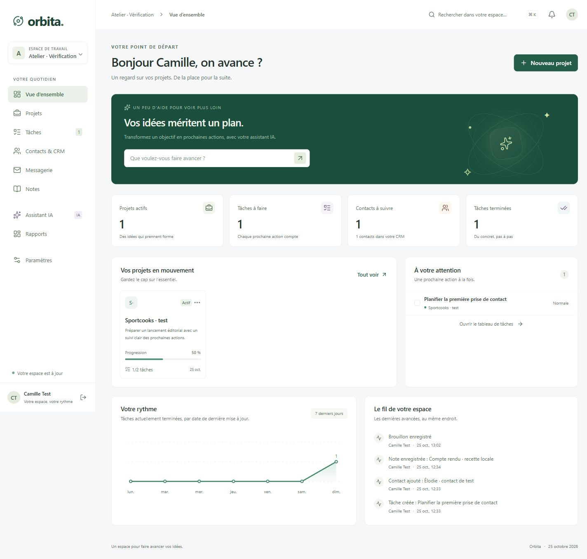

# Orbita

Un espace de travail pour faire avancer ses projets avec l'IA : projets, tâches,
contacts, notes et bilans, dans une interface française.

**Java 25 · Spring Boot 4.1.2 · Maven · React · TypeScript**

## Démarrer

Docker avec Docker Compose suffit :

~~~sh
docker compose up --build -d
~~~

Sous Windows, lancez `run.cmd` : il construit et démarre Orbita, attend son
démarrage puis ouvre l'application dans le navigateur.

Ouvrir [Orbita sur localhost](http://localhost:8080), créer un compte et son
premier espace. Les données sont conservées dans un volume. L'application démarre
vide, sans compte ni intégration externe préconfigurés.

Le [guide de lancement](docs/running.md) décrit aussi Maven sans Docker,
PostgreSQL, OpenAI, Ollama, SMTP et GitHub.

## Disponible dans cette version

- Plusieurs espaces isolés, comptes, membres et rôles.
- Projets avec objectifs, état, couleur et archivage.
- Tableau de tâches, priorités, responsables, échéances et blocages.
- CRM avec suivi des contacts, recherche, CSV et exclusions de prospection.
- Notes partagées ou privées, protégées aussi dans les exports et le contexte IA.
- Plans IA structurés, modifiables, puis créés en tâches après validation.
- Brouillons et envoi SMTP confirmé, lorsque le serveur est configuré.
- Lecture de l'activité des dépôts GitHub associés aux projets.
- Indicateurs réels, rapports, impression/PDF et export JSON de l'espace.
- Interface responsive et page de repli hors connexion sans cache métier.

Cette version est une première tranche locale. Gmail entrant, les campagnes,
Stripe/AdSense/GA4, les push et la commercialisation SaaS restent à livrer.
Voir la [matrice fonctionnelle](docs/delivery.md).

## Développer et vérifier

JDK 25 et Node.js 24 LTS ; Maven est fourni par le Wrapper.

~~~sh
./mvnw -Pweb verify
java -jar target/orbita-0.1.0-SNAPSHOT.jar
~~~

Sous Windows, utiliser `.\mvnw.cmd`. Le profil `web` construit l'interface et
l'inclut dans le JAR. Le guide décrit le rechargement du frontend en développement.

~~~sh
./mvnw verify
npm --prefix frontend test
npm --prefix frontend run build
~~~

## Tickets et merge requests

La capture utilise une base de recette séparée ; le produit démarre sans données préremplies.

Un ticket GitHub → une branche `codex/<numero>-<description>` → une PR vers
`main`. La CI vérifie le lien au ticket, Java, TypeScript, les tests et le
formatage. `main` exige les contrôles verts et une fusion par squash.

- [Contribution](CONTRIBUTING.md)
- [Consignes pour les agents](AGENTS.md)
- [Vision du produit](docs/vision.md)
- [Backlog](docs/backlog.md)
- [Décision d'architecture Java](docs/architecture/0001-java-workspace.md)
- [Livraison et limites](docs/delivery.md)
